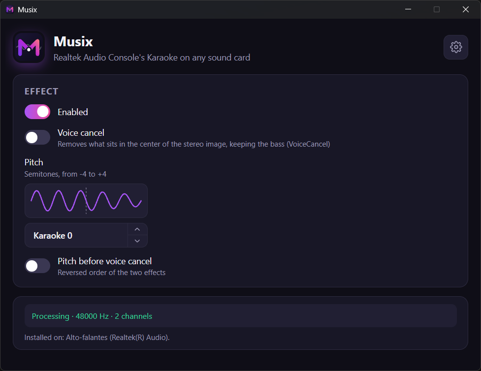

# Musix

The karaoke effect from the Realtek Audio Console, on any sound card.

<p align="center">
  
</p>

The Realtek Audio Console has a karaoke mode that takes the vocals out of whatever is playing and lets you change the key of the song. It only shows up on PCs with a Realtek chip and driver. Musix gives you the same effect on any output: HDMI monitors, USB headsets, Bluetooth headphones, NVIDIA or AMD audio, or the Realtek itself.

It works on the whole system. Spotify, YouTube in the browser, a video player, a game: anything playing through that output gets the effect. No plugins or virtual audio cables.

## What it does

**Voice cancel** removes what sits in the center of the stereo mix, which is where the lead vocal usually is, and keeps the bass so the song doesn't go thin. It works best on studio recordings. Live recordings and vocals with a lot of reverb can leave some voice behind.

**Pitch** moves the song up or down by up to 4 semitones so you can sing it in a key that fits your voice. The tempo doesn't change.

You can use either one on its own or both together, and swap the order in which they're applied. Changes are instant, with the music playing.

The app is available in English and Portuguese.

## Installing

You need Windows 10 or 11, 64-bit.

1. Download the installer from [Releases](https://github.com/pedrocmota/musix/releases) and run it. It installs to `C:\Program Files\Musix`.
2. Open Musix, click the gear icon and click **Install** next to the output you listen on. Windows asks for administrator permission and the sound drops for a second.
3. Go back and turn on **Enabled**.

When the effect is running, the box at the bottom says *Processing* along with the sample rate. If it says the APO hasn't loaded yet, play something on that output.

You can install it on more than one output. The settings on the main screen apply to all of them.

## Good to know

- Nothing gets removed when you install. If the output already has Realtek's or another manufacturer's effects, Musix runs alongside them. On outputs using the standard Windows effects Musix takes their place, and uninstalling puts them back.
- It has no effect when *Audio enhancements* is turned off for that output in Windows, or on apps that use exclusive mode (ASIO, WASAPI exclusive), which some DAWs and audiophile players do.
- On Bluetooth it only works in the music profile (A2DP). When a headset switches to hands-free for a call, the effect is gone until it switches back.
- Updating or reinstalling the sound driver removes Musix from that output. Just click Install again.
- To remove Musix completely, click **Uninstall** on each output first and then uninstall the app from Windows. If you skip the first step, the effect stays on those outputs.
- If an install fails and the PC ends up without sound, restart it. If that output is still silent, open Musix and uninstall it from there.

## How it works

Musix is an APO (Audio Processing Object), the kind of plugin Windows loads into its audio engine for each output. The processing is the same as Realtek's, ported from their driver, and uses well under 1% of a CPU core. The app registers it on the output you pick, backs up the original settings and sends your changes through a file in `C:\ProgramData\Musix`.

To build it you need Rust, Node 20+ and the Visual Studio Build Tools:

```bat
scripts\build-apo.cmd
npm install
npm run tauri build
```
